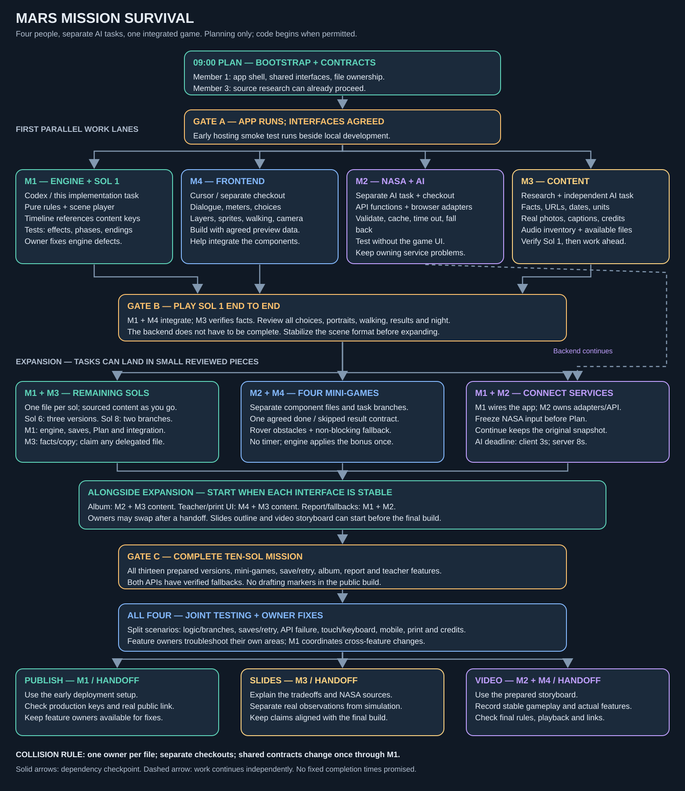

# Mars Mission Survival — team and AI implementation workflow

Prepared November 14, 2026. Planning and agent handoff only; this document does not create an application or authorize coding before the team's permitted start.

**Team start plan: 09:00 Asia/Rangoon.** Follow the event's actual coding-start requirements. Create the new implementation project when permitted and carry over only permitted preparation materials. Do not mistake this planning document for implementation already completed.

## 1. Read this first — humans and agents

The objective is one browser-playable Mars mission for ages 7–12: knowledge through fun. Build a reliable playable mission before visual polish. Any AI opening this file must read the source documents before implementing its assigned task.

Source order:

1. The team's current explicit decisions and task instructions.
2. [README.md](../README.md), especially **CONFIRMED UPDATE**, engine rules, exact IDs, balance tables, fallbacks and saving behavior. This owns product scope and gameplay rules.
3. [story-script.md](story-script.md): approved readable writing, including support copy. [facts.md](facts.md): the source-verification ledger; currently not a completed fact check.
4. [PROJECT_STRUCTURE.md](PROJECT_STRUCTURE.md): folder responsibilities. Use its current preparation status and the README writing status.
5. This workflow: coordination, task boundaries, dependencies and integration. It does not override the game specification.
6. [export-manifest.json](../asset-preparation/export-manifest.json) and [artwork preparation notes](../asset-preparation/README.md): physical file sizes, logical display sizes, sprite registration and preserved originals.

If documents disagree, identify the exact conflict and resolve it with Member 1. Do not invent a replacement rule, silently rename IDs, add a feature or alter confirmed numbers.

**Current starting point:** the existing repository has folder scaffolding, planning/content documents and prepared artwork. It does not yet contain the runnable game. Prior asset cleanup is not proof that the whole scene composition or art style is final.

## 2. Visual overview



[Open the SVG separately](team-workflow.svg). The diagram shows dependencies, not guaranteed durations. Research can begin while the initial technical foundation is established. Backend work can run beside the offline Sol 1 build.

## 3. Confirmed scope — do not redesign it

- One mission; fixed ten-sol order; thirteen prepared scene versions. No gameplay schedule randomization or random seed.
- Exact event IDs, in order: `touchdown`, `first_night`, `dust_storm`, `ice_hunt`, `calling_earth`, `solar_storm`, `equipment_failure`, `leak` OR `meteors`, `cold_night`, `finale`.
- Sol 6 uses `calm`, `active` or `stormy` from the frozen NASA input. The event ID remains `solar_storm`.
- Sol 8 is `leak` when the earlier repair set `quickPatch`; otherwise `meteors`.
- Plan cargo packages, three meters, authored choices and confirmed effects. Do not redesign cargo as arbitrary item quantities.
- Four optional mini-games: `cover_panels`, `rover_drive`, `repair_wires`, `patch_leak`. Skip is always available. Completion bonuses apply once; skipping does not introduce a penalty.
- Rover Drive keeps obstacles, tap and keyboard routing, friendly blocked-move feedback and the `obstacleBlocking` setting for its simple waypoint fallback. No losing state or countdown.
- NASA Real-Sky, bundled real NASA photo cards/album, AI debrief with local templates, Teacher Pack, classroom pauses, gentle failure and retry stay in scope.
- No database, accounts, cross-device saves, Free Play, Story/Daily mode selector, quiz or AI-generated story events.
- Continue uses browser storage with the specified fallback. A saved run retains its cargo, NASA snapshot and progression; Continue does not fetch new sky conditions.
- Only the simulator may have a random seed for reproducible random-choice sampling. Scene files are timelines, not random seeds.

## 4. Architecture and scene files

Use **one repository and one deployment**. The frontend is `src/`; the backend functions are `api/`. Earlier conversational examples using `frontend/src/game/` are conceptual, not a second directory tree to create.

| Area | Responsibility |
|---|---|
| `src/engine/` | Pure TypeScript rules, state, choices, cargo, ending checks, snapshots and scene sequencing. No React or network calls. |
| `src/engine/scenes/` | One authored timeline file per sol. Create after coding starts. |
| `src/content/` | Structured writing, effects, facts, photos, mood/spot metadata and fallback content. |
| `src/services/` | Browser adapters for NASA, debrief and storage. |
| `src/ui/components/` | Reusable presentation and the scene-rendering adapter. |
| `src/ui/screens/` | Title, Plan, prologue, Scene, report, Learn, Teachers, Sources and Settings. |
| `src/ui/minigames/` | Four independent task components. |
| `api/` | `/api/sky` and `/api/debrief`; no second application server by default. |
| `public/assets/` | Runtime images/audio/photos. Do not copy every original into the public deployment. |
| `public/teacher/` | Finished static teacher downloads, where needed. |
| `docs/`, `scripts/`, `tests/` | Writing/sources, validation/simulation and relevant cross-feature tests. |

Planned timeline files:

```text
src/engine/
  scene-types.ts
  scene-player.ts
  mission.ts
  scenes/
    sol01-touchdown.ts
    sol02-first-night.ts
    sol03-dust-warning.ts
    sol04-ice-hunt.ts
    sol05-calling-earth.ts
    sol06-solar-encounter.ts
    sol07-equipment-failure.ts
    sol08-leak-or-meteors.ts
    sol09-cold-night.ts
    sol10-finale.ts
```

`mission.ts` coordinates mission initialization/selection, with the existing planned `schedule.ts` owning the fixed slots. `scene-types.ts` imports existing IDs/state types rather than declaring competing copies. `scene-player.ts` advances timeline state and emits presentation requests; UI/audio/browser animation code belongs in the presentation layer.

**Content ownership is important:** the README assigns dialogue/UI/After text to `story.json`, gameplay numbers to `balance.ts`, `cargo.json` and `events.json`, and facts/photos/templates to their content files. Timeline TypeScript references those IDs/keys. Do not paste a second copy of dialogue or balance values into every timeline. A timeline says which speaker/expression/text key/camera/music/choice runs when.

Sol 6's file holds the three prepared variants; Sol 8's file holds both branches. No variant generates new dialogue. Event/camera/effect cues use stable IDs, not brittle array positions.

## 5. People, tools and ownership

The assignments below are the agreed starting plan. They are ownership boundaries, not claims that one AI product is inherently better. A task can change owner after an explicit handoff.

| Person | First lane | Suggested working surface | Continuing responsibility |
|---|---|---|---|
| Member 1 — project lead | Engine, scene player, complete Sol 1 | This Codex chat in the implementation checkout | Contracts, integration, mission expansion and final review. Not all debugging. |
| Member 4 | Frontend components and layered outpost | Cursor, separate branch/checkout | Help integrate their components; fix UI bugs; later mini-games and print UI. |
| Member 2 | NASA and AI backend functions | Separate AI chat/task and checkout | Own backend/client-adapter integration and backend failures; later mini-games and album. |
| Member 3 | Facts, sources, photos, captions, audio inventory | Research plus a separate AI content task | Work with Member 1 on remaining scene content and verify player-facing science. |

Do not run two independent coding agents in the same working directory. On one computer, use separate clones or Git worktrees on different branches. On different computers, each person uses their own clone and task branch. Shared contracts are agreed through Git/handoffs, not by keeping agents in one giant conversation.

Member 2 can use an AI assistant independently, but should not inject backend implementation into Member 1's active engine task. When troubleshooting, the feature owner investigates first; Member 1 handles cross-feature decisions and integration.

## 6. Collision-prevention rules

1. **One active owner per file.** Before starting, declare the branch, files/directories owned, interfaces consumed and acceptance check.
2. **Branch from an integrated checkpoint.** After bootstrap lands on `main`, all initial lanes start from that checkpoint. Later tasks update from the tested integration point.
3. **Keep `main` usable.** Task owners hand over reviewed, relevant checks and a small change. Member 1 integrates completed pieces in sequence. No force-pushing shared branches or committing secrets.
4. **One dependency owner:** Member 1 initially owns package files, lockfile, Vite/TypeScript/test/deployment configuration and shared scripts. Other lanes request dependencies before changing them. Routine component work should use the agreed installed stack.
5. **One integration owner:** Member 1 owns `src/App.tsx`, app entry points, feature flags, central mission registry and shared state/scene contracts. Other tasks supply components/adapters with documented props rather than wiring themselves into the entire app.
6. **Core rules stay in the engine.** UI and mini-games never subtract meters or award bonuses independently. They return actions/results; the engine applies effects exactly once.
7. **Do not edit outside the task boundary just to fix a build.** Report the actual incompatible interface and coordinate its change. The owner of the contract changes it once and notifies consumers.
8. **No silent edits to approved writing or numbers.** Content corrections have evidence and a clear handoff. Verified facts do not automatically turn normalized game units into NASA-measured quantities.
9. **Keep work visible.** Update the task record at checkpoints, when blocked or when transferring ownership. Don't spend time narrating unchanged status.
10. **Keep keys private.** Local ignored `.env`; production hosting environment settings. Never `VITE_`-prefix NASA/Gemini secrets or place them in public files, screenshots or Git.

### File ownership after the first checkpoint

| Owner | Primary files | Explicit exceptions / handoff |
|---|---|---|
| Member 1 | `src/engine/**`, storage service, app wiring, config/lockfile, engine tests and simulator | Member 2 owns the agreed solar classification module `src/engine/sky.ts`. Timeline files can be delegated individually after the Sol 1 gate. |
| Member 4 | Assigned `src/ui/components/**`, outpost/scene presentation, assigned screen/style files | Do not edit app wiring or all shared styles at once. Agree exact stylesheet paths. |
| Member 2 | `api/**`, `src/services/sky.ts`, `src/services/debrief.ts`, `src/engine/sky.ts`, corresponding service/API tests | Do not edit storage or general engine rules. Consume the agreed state/payload types read-only. |
| Member 3 | `docs/facts.md`, sourced photo records, approved captions and assigned content files | Member 1 owns the first runtime `story.json` conversion for Sol 1; transfer its ownership to Member 3 afterward. No concurrent edits to that file. |

Each member owns the bug fixes in their delivered area. Ownership of a newly assigned mini-game, album, print screen or individual scene must be recorded before an agent starts it.

## 7. The working process and dependency gates

### Phase A — permitted start, bootstrap and contracts

**Lead: Member 1.** Member 3 can research in parallel. Members 2 and 4 review the interfaces and prepare task inputs; they should not create competing scaffolds.

- Create the permitted implementation folder/repository and bring in the permitted README, writing and runtime assets.
- Bootstrap the agreed React/Vite/TypeScript app, server-function setup and meaningful test commands. Use one package/lockfile.
- Confirm a clean checkout can install and start. Record exact commands in the project documentation; agents must not assume commands exist before bootstrap defines them.
- Make an early minimal deployment/smoke test. Member 2 can perform the deployment check after receiving the bootstrap; Member 1 owns any shared config change.
- Freeze the minimum interfaces in a shared contract record: IDs, game state, action/effect resolution, timeline steps, renderer callbacks, mini-game result, sky response, debrief payload/response, content keys and save versioning.
- Decide text-key naming once; preserve the existing event/choice IDs. Define asset frame metadata using physical and logical sizes.

**Gate A passes when:** the empty app runs; one implementation architecture is agreed; shared contracts and file ownership are explicit; API services can be developed with fixtures and UI components with preview data. A successful early hosting smoke check should be pursued without blocking offline engine work on an unrelated hosting issue.

### Phase B — four lanes run in parallel

#### B1. Member 1: engine + scene player + Sol 1

- Implement the pure rules from README: cargo modifiers, pending effects, sol start, RESULT, mini-game bonus, clamp, immediate failure check, NIGHT and final check. Keep science/flags separate from the three meters.
- Implement stateful timeline progression; dialogue waits for a child to continue. Walking/effects can have short skippable durations. Do not make a child finish reading before a timer expires.
- Create Sol 1's timeline referencing content keys. Include speaker/expression, mood/camera requests, hotspot/walk, choice and After path. Resolve confirmed effects through the engine.
- Include real ending checks and the action/checkpoint boundaries. Use a valid, clearly identified development sky fixture while services are unfinished; do not mislabel fixtures as live data.
- Test calculation/transition behavior, not just whether functions were called.

#### B2. Member 4: frontend components + outpost

- Build responsive dialogue/narration, portraits, meters, choice panel, hotspots, Commander presentation and scene layers from the agreed props/callbacks.
- Use a small preview screen or component harness. It can demonstrate different speakers, expressions and narrow-screen layouts without rewriting `App.tsx`.
- Keep controls/text as HTML/CSS/SVG. Keep decorative overlays below controls and ignore pointer input. Use physical frame dimensions for sprite cropping and logical size for the scene.
- Audio belongs to the browser presentation layer; allow the initial user interaction to enable it and keep mute/Reduce Motion usable. Missing recordings must be reported; do not reference nonexistent files as completed audio.
- Camera/effect cues use event IDs. Do not add new resources, choices or game state to make a visual demo work.

#### B3. Member 2: independent backend and adapters

- Implement `/api/sky` and `/api/debrief` with validation and server-only configuration.
- NASA: use documented current DONKI endpoints; verify classification assumptions and source metadata. Initial query window, cache policy and fallbacks follow README. Return the agreed response, including observation versus fetch dates and Live/Cached/Saved status.
- Do not implement database-backed player saves or a second general-purpose application server. Cache using hosting-supported mechanisms; function memory is not guaranteed durable across instances.
- Implement the browser sky adapter and verified bundled fallback; late responses must not change a started run.
- AI: validate compact structured input, request 2–3 child-appropriate sentences, target 40–60 words and never over 60. Read `GEMINI_MODEL` from verified configuration; do not guess a model name from conversation.
- Server timeout is 8 seconds. The browser has an independent 3-second display deadline and local template fallback. A late AI reply never replaces a summary already displayed. Player free text/names are not required.
- Test service behavior independently: invalid response, outage, timeout, absent configuration and cached/saved paths. Simulated failures are development tests, not falsely labeled NASA observations.

#### B4. Member 3: verified content and media inventory

- Check each factual claim against a specific NASA/agency page or study; keep a source URL, observation/publication date, verification date, units/location where relevant, and child-friendly wording.
- Distinguish fixed science facts, actual observations and fictional mission events. `[DATA]`/`[CHECK]` are drafting markers, not player copy.
- Prepare photo IDs, image sources/credits, alt text and captions tied to event/variant IDs. Use real curated saved images; no live-photo integration or generated NASA photos.
- Record source/tool/license details for audio and images. Supply available filenames and cue purposes. Never promise all effects are ready when a sound is missing.
- Review Sol 1 content first so it can enter the first playable checkpoint. Then work ahead through remaining scenes with Member 1.

**Gate B — integrated Sol 1:** Members 1 and 4 connect engine/timeline and presentation. Member 3 verifies the factual text. Backend integration can still use the agreed fixture/fallback at this gate.

Acceptance:

- The child can read narration, tap the destination, walk, read dialogue, choose and see the correct After line and meter changes.
- All Sol 1 choices reach their correct result; repeated taps don't resolve a choice twice.
- Night processing and ending checks occur in the right order.
- Speaker/expression, camera/movement and sound cues or explicitly missing audio are reviewed together.
- UI works with touch/keyboard and at narrow width. No unverified drafting marker is presented as a fact.
- The shared scene format is now stable enough to repeat. Do not write all remaining timelines against an untested format.

### Phase C — expand the mission, services and mini-games

**Lane C1: Member 1 + Member 3.** Implement Sols 2–10 as separate timelines, verified content and branches. Member 3 owns assigned writing/source files; Member 1 owns engine changes and timeline integration. If Member 3 codes a timeline, claim that specific file first. Keep Sol 6's three variants together and Sol 8's two branches together.

For each sol:

1. Read its approved Markdown, exact effects and flags.
2. Verify the facts/data and record sources while implementing it.
3. Create timeline steps referencing content keys: scene mood, music cue, speaker/expression, camera, movement, choice, mini-game request, result, After line and photo invitation.
4. Check previous-sol callbacks, cargo adjustments and later consequences.
5. Exercise every choice and the relevant branch conditions; review the real displayed wording and resource outcomes.
6. Mark the sol complete only after content and behavior checks. Queue unresolved art/audio with an honest status rather than declaring it finished.

**Lane C2: Members 2 + 4.** Build the four mini-games in separate files after the result/Skip contract is stable. Suggested ownership: Member 4 starts Rover Drive then Cover Panels; Member 2 starts Repair Wires then Patch Leak when backend work permits. Record any reassignment.

- Each game gets input from the engine and reports `done` or `skipped` once.
- The engine, not the component, applies the confirmed completion bonus once: +2 Life for Rover Drive and +2 Power for the other three tasks.
- No countdown or failure screen. No forced dragging. Use clear instructions, touch/keyboard support and Skip throughout.
- Rover Drive includes an obstacle route with a guaranteed solution, friendly blocked feedback, and the same component with `obstacleBlocking: false`.
- Build/test games in their own preview harness; Member 1 integrates each into the relevant scene after handoff.
- If a development task stub is necessary while a mini-game is unfinished, label it as a development stub and do not claim it as a finished feature.

**Lane C3: application flow and real API integration.** Member 1 owns Title/Plan/Continue wiring; Member 4 can own their screen components through a handoff. Member 2 connects and troubleshoots the service adapters. Do not transfer every backend problem to Member 1.

- Start Mission reads NASA input once before Plan. Freeze data and variant once the run starts; cargo advice is optional.
- Continue restores the same snapshot and progress without a new lookup.
- Storage handles invalid/version-incompatible/unavailable saves as specified. Durable Continue checkpoints must not reapply RESULT or NIGHT.
- In-memory sol-start retry is distinct from durable Continue. Restore cargo, frozen input and beginning-of-sol state; don't promise it survives closing the browser.
- Keep the report available regardless of NASA/AI service availability.

**Expansion checkpoint:** a complete ten-sol mission works; all three solar versions and both Sol 8 branches can be exercised; mini-games return correctly; Continue/retry and API fallback behavior are integrated. Gate C also requires the overlapping Phase D features below. Individual subfeatures can land earlier; don't hold a finished component for one giant final merge.

### Phase D — album, Teacher Pack, report and debrief

Begin each task as soon as its dependencies are stable; do not wait unnecessarily for every sol to be polished.

| Task | Proposed owner | Must have first | Handoff |
|---|---|---|---|
| Photo cards / album / album printing | Member 2 after their mini-games, with Member 3 supplying content | Photo schema/approved records; engine exposes encountered IDs | Components + tests/preview; Member 1 connects history/state. |
| Teacher screen / print layout / classroom presentation | Member 4 after their mini-games; Member 3 supplies educational copy | Confirmed Teacher Pack scope and classroom-pause interface | Printable output checked in print preview; no account/voting mode. |
| Report, gentle endings and retry integration | Member 1, with screen components delegated to Member 4 if needed | Engine outcomes and history | Accurate results including final-night failure; no premature success sequence. |
| Local debrief templates and real AI connection | Member 1 builds payload/fallback selection; Member 2 owns service behavior; Member 3 verifies wording | Report payload, actual history and template keys | Reliable template output even when AI fails or responds late. |

Teacher Pack includes the confirmed lesson plan, event-matched questions, vocabulary, prediction/choice/result worksheet, Mission Album printing and certificate. Classroom is a setting on the same mission. Do not drop the worksheet or add a quiz.

Photo invitations are optional; encountered IDs enter the album even if the child doesn't open each card. Bundle photos with the site and label them Saved photo independently of the sky status. No generated picture is presented as a NASA photograph.

AI can summarize real recorded choices only. Don't invent a consequence or claim cargo prevented failure without evidence. Display the report immediately; local fallback remains a first-class completed implementation.

**Gate C — complete feature set:** the ten-sol mission and all overlapping Phase D deliverables are integrated, with verified fallbacks. This is the complete-mission gate shown in the diagram, not permission to postpone component checks until now.

### Phase E — joint validation and bounded polish

All four members test. Assign scenarios, not four people repeating the same happy path. Feature owners fix their own defects; Member 1 handles cross-feature changes and reviews integration.

| Test set | Checks |
|---|---|
| Mission logic | Every authored scene/choice, solar levels, quickPatch branch, pending penalties/cargo effects, zero-meter checks and final-night failure. |
| Mini-games | Complete/Skip, repeated tap, keyboard/touch, blocked Rover move, disabled blocking and return to the correct story step. |
| Storage | Reload at durable checkpoints; no duplicate effect; invalid save; unavailable storage; Continue versus sol retry. |
| NASA | Live valid response; malformed/empty/unavailable data; cached/archive fallback; late response; honest source/date labeling. Empty data is not silently a calm observation. |
| AI | Accepted response; long/invalid output; missing key; failure/timeout; 3-second template display; late result doesn't replace it. |
| Presentation | Mobile/desktop, long text, focus/tap targets, mute, Reduce Motion, readable meters, print layout and actual asset loading. |
| Content | No visible `[DATA]`/`[CHECK]`; citations support specific claims; correct units/dates; photo credits; clear simulation wording. |

Run meaningful engine/content/integration checks and the production build. Use the balance simulator to identify whether each solar level has viable choices/loadouts; don't silently change starter values. Record proposed balance changes for review and update the owning data once approved.

Polish only after a working flow exists. The team already identified the current setting differs from the reference. Preserve the layered architecture, but don't block core gameplay on a complete scenery regeneration. Plating fit, panel design/perspective and helmet edits remain explicit artwork tasks, not automatically completed by transparency cleanup.

**Release-validation checkpoint:** the public-facing content is verified or uses verified saved fallbacks; the mission can finish without either external service; known material defects are resolved or clearly reported. Don't claim unavailable offline/PWA functionality just because local files are bundled.

### Phase F — publishing and presentation

Suggested final split: Member 1 publishing/integration; Member 3 slides/science explanation; Members 2 and 4 video recording/editing. The team may swap these roles at a recorded handoff. Backend/UI owners remain available to fix defects in their areas.

Prepare the slide outline, video storyboard and submission checklist earlier, beside development. Record final gameplay only when the demonstrated flow is stable. Do not promise a specific video length/file format or submission field without checking the current official submission requirements.

- Use the early deployment to catch hosting issues before the end. Final deployment includes server environment settings and a production smoke test, not just a local build.
- Test the actual public link from another device/session. Check both API success and failure and the bundled fallback assets.
- Include source/data attribution, AI/tool disclosure and required credits. Do not expose secrets or private preparation material in public files.
- Prepare the public URL/repository/demo materials required by the verified submission instructions; test links and playback.
- Keep the README/submission claims accurate about what is implemented, what uses real data and what is simulated.
- Freeze the final build while recording. Further fixes should trigger a quick check that the video and screenshots still match it.

## 8. Contract checklist — complete at Gate A

This is a checklist of interface decisions, not prewritten implementation. Exact TypeScript definitions are created at the permitted coding start by Member 1 with consumers reviewing.

- [ ] Existing event/choice/cargo/spot/mood/mini-game IDs reused.
- [ ] Engine state and action/effect application order; one owner of meter mutations.
- [ ] Scene step types: scene/mood, dialogue key + speaker/expression, walking/target, camera/effect/audio cue, choice, mini-game request and result/card progression.
- [ ] Renderer completion callbacks and behavior for Skip, Reduce Motion and tap-to-continue.
- [ ] Mini-game interface, result enum and completion-once guarantee; Rover fallback setting.
- [ ] Sky response: query date, level, event metadata, observation/fetch times, source URL/status; unavailable state and verified fallback semantics. Preserve the README response shape or explicitly agree backward-compatible detail additions.
- [ ] Classification rules verified/documented; classification shared once rather than separately reimplemented in frontend and backend.
- [ ] AI structured input/response, client deadline and server timeout; local template ownership.
- [ ] Save content version, durable checkpoint boundary and separate memory-only retry snapshot.
- [ ] Photo/fact/text-key schemas and authoring ownership.
- [ ] Physical sprite dimensions, logical display size, frame order and anchors.
- [ ] Local development, test/build and server-function commands; deployment configuration owner.

## 9. Task board and handoff format

Use a shared team board/document. Do not let four agents simultaneously rewrite the same status Markdown file in their local branches and then treat all versions as authoritative. A human coordinator can consolidate the board; branches carry their own handoff notes.

Track: **task ID | owner | branch/checkpoint | owned paths | dependencies | status | acceptance evidence | next owner**.

Status values: `ready`, `in progress`, `blocked by <specific dependency>`, `ready for review`, `integrated`. “Works on my screen” is not acceptance evidence. Name the exercised scenario/check and any limitation.

Each handoff contains:

1. What was built and changed paths.
2. Contract version/checkpoint consumed; any proposed contract change.
3. Exact run/check commands and results.
4. How to exercise it manually, including failure/Skip where relevant.
5. Required configuration, expressed as variable names only.
6. Known missing content/art/audio or remaining defects.
7. The minimal wiring another owner must add. Do not make that wiring behind their back.

Keep changes small enough to review and integrate. Coordinate commits, pushes and merges with the task owner; this workflow is not an instruction to publish or overwrite a teammate's branch automatically.

## 10. Copy this into a new AI task

Replace the bracketed fields. An agent should implement the selected task, not the entire project.

```text
Project: Mars Mission Survival, ages 7–12, knowledge through fun.
Read docs/TEAM_WORKFLOW.md, README.md's CONFIRMED UPDATE and relevant rules,
docs/PROJECT_STRUCTURE.md, and the writing/source files needed for this task.
README owns product decisions. The workflow owns coordination.

My identity/owner: [Member and role]
Current phase and integrated checkpoint: [Gate/commit]
Task: [One concrete deliverable]
Branch and separate checkout: [Path/branch]
Allowed files: [Exact paths]
Read-only dependencies: [Shared contracts/content]
Required interface: [Contract names/versions]
Acceptance checks: [Specific behavior and meaningful checks]

Do not create a second frontend/backend project. Frontend is src/, backend is api/.
Do not change IDs, approved rules/numbers, dependencies, shared contracts, app wiring,
or someone else's files unless that change is explicitly handed to you.
Scene timelines reference story/content keys; effects come from engine-owned data.
Do not invent NASA observations, sources, photos, audio availability or passing tests.
Use fixtures only for clearly identified development previews/tests.
Keep API keys server-side. Do not add a database, random schedule or new modes.
If blocked, report the specific dependency and continue independent work in scope.
Run the relevant checks, inspect the result and provide the seven-part handoff.
Do not automatically push/deploy/merge; follow the task owner's instructions.
```

## 11. Overall completion checklist

- [ ] A: new permitted project; runnable bootstrap; minimum contracts and ownership agreed.
- [ ] Early hosting smoke test recorded; shared config problems owned.
- [ ] B: integrated Sol 1 works; scene format reviewed before expansion.
- [ ] All ten timeline files and thirteen authored versions implemented and sourced.
- [ ] Title, Plan, prologue, Continue, settings and engine rules integrated.
- [ ] NASA fetch/cached/archive paths work; input freezes before Plan.
- [ ] Four mini-games work with Skip and accessible controls; Rover obstacle fallback works.
- [ ] Photo cards, album and credits work with curated real saved images.
- [ ] Gentle failure, retry, history/report and final-night checks work.
- [ ] Local debrief templates and optional real AI response meet timing/content rules.
- [ ] Teacher Pack, worksheet, album printing, certificate and classroom pauses work.
- [ ] Sources verified; no draft markers presented to children; actual audio/art gaps reviewed.
- [ ] Joint balance, branch, storage, API-failure, accessibility and mobile checks passed.
- [ ] Production build and actual public-link smoke checks passed.
- [ ] Current submission requirements checked; slides/video/links match the final build.

**Critical path:** bootstrap/contracts → engine + interface → integrated Sol 1 → complete mission → validation → final deployment/submission. Research, backend work and later independent components run beside that path at their dependency gates.
